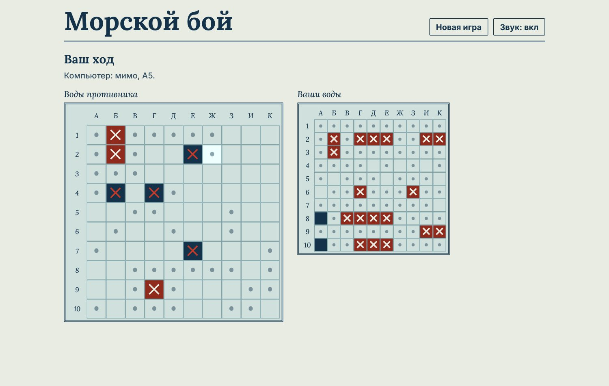

# Морской бой · Battleship



Классический морской бой на поле 10×10. Расставьте флот и найдите корабли противника раньше, чем он найдёт ваши.

**Играть:** https://muzara.github.io/battleship/

## Режимы

- **Против компьютера.** Компьютер не стреляет наугад: он добивает раненые корабли, а пустое поле прочёсывает в шахматном порядке.
- **Вдвоём на одном устройстве.** Между ходами показывается экран передачи, чтобы соперник не видел ваш флот.

Расстановка вручную или случайная. Корабль поворачивается кнопкой, клавишей R или правой кнопкой мыши. Попали — стреляете ещё раз. Корабли не касаются друг друга.

Флот: один четырёхпалубный, два трёхпалубных, три двухпалубных и четыре однопалубных.

## Языки

Русский, кыргызский и английский. На английском координаты латиницей (A–J). Язык переключается в правом нижнем углу или ссылкой `?lang=ru`, `?lang=ky`, `?lang=en`.

## Запуск

- Откройте `index.html` в браузере.
- Или включите GitHub Pages: **Settings → Pages → Deploy from a branch → main / (root)**.

## Файлы

```
index.html      страница игры
battleship.js   логика игры, компьютер-соперник, тексты на трёх языках
games.css       оформление
```

---

**English.** Classic Battleship on a 10×10 grid. Play a computer that hunts down damaged ships, or a friend on the same device. Available in Russian, Kyrgyz and English.

Автор: Музар Алияскаров, студия «Клетка».
